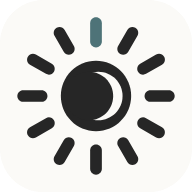
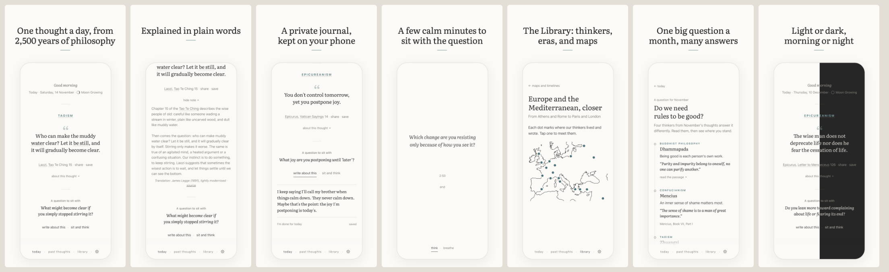

  

<h1 align="center">The Thinking Place</h1>

<em>Philosophy, one day at a time.</em>

<a href="https://thinkingplace.app"><b>Open The Thinking Place →</b></a>

The Thinking Place is a free daily-philosophy app. Every day it shows one short passage from the great thinkers of East and West, with a short note that gives it its context and a question to help you think it through. It takes a minute to read; the thinking can take as long as you like.

It's a beginner's guide to philosophy, not a meditation app. Free, with no ads, no tracking, and no account.

## What's inside

- **A thought a day** from twelve paths: Stoicism, Epicureanism, Classical Greek Philosophy, Enlightenment Ethics, Existential Thought, Humanists and Essayists, Buddhist Philosophy, Indian Philosophy, Taoism, Confucianism, Japanese Aesthetics, and Persian and Sufi Poetry.
- **A note and a question** with each thought, and underlined words that explain a name or an idea.
- **A private journal:** write what comes to mind, and meet your earlier notes when a thought comes back.
- **Sit and think:** a few quiet minutes with the question, with soft rain, waves, or wind if you like.
- **The Library:** short pages on the thinkers, their paths, their times, and the big questions, with maps and timelines. [Read it on the web →](https://thinkingplace.app/library/)
- **A question for each month,** answered by several thinkers from different paths.

## Where it runs

- **On a computer:** [in your browser](https://thinkingplace.app/app/), nothing to install.
- **On Android:** [get it on Google Play](https://play.google.com/store/apps/details?id=app.thinkingplace), with a daily reminder if you like.
- **On iPhone:** coming soon to the App Store (currently in review by Apple). Until then, open it in Safari and [add it to your home screen](https://thinkingplace.app/iphone.html).

It works offline once it has opened once.

## Private by design

Your notes stay on your device. They are never sent to us or to anyone else, and there is no account and no server copy. The app uses no analytics, no cookies, and no tracking. Export your notes from Settings now and then to keep your own copy. [Terms & privacy →](https://thinkingplace.app/terms.html)

## The texts

Every quotation comes from a public-domain text or translation, and each one is checked word for word against its source. The source is credited under every thought, with a link to read the full text. A few older translations are lightly modernised, and a few French passages are our own translations; both are noted under the thought.

## About this repository

This repository holds only the published website, [thinkingplace.app](https://thinkingplace.app). It is built and updated automatically, every night too, and served by GitHub Pages. The app's source is kept elsewhere.

Questions or feedback: [hello@thinkingplace.app](mailto:hello@thinkingplace.app) · [More questions and answers](https://thinkingplace.app/questions.html)

---

© 2026 The Thinking Place. All rights reserved. The quotations are in the public domain; the notes, questions, Library pages, design, and code are not, and may not be reused without permission.
